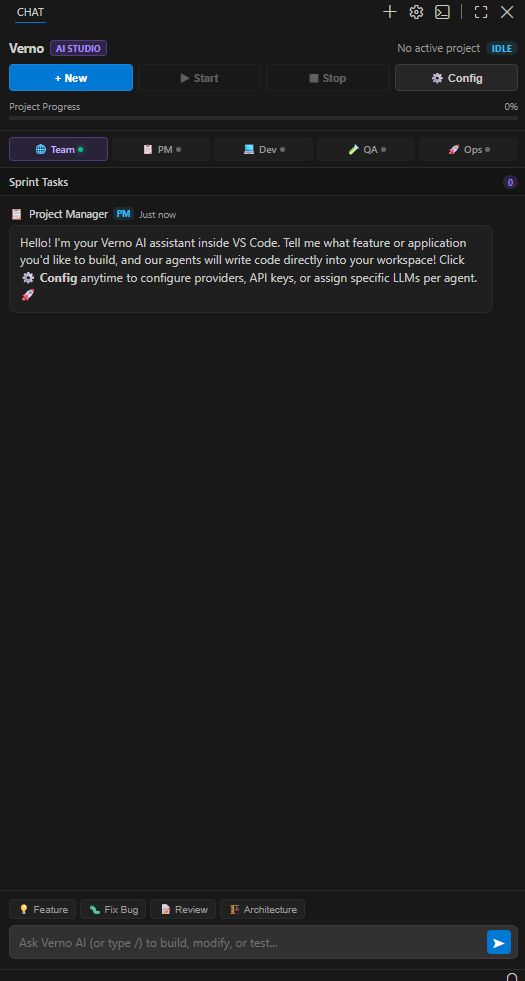

<div align="center">

# 🌌 Verno AI Studio
### The Autonomous Multi-Agent Software Development Studio Built on VS Code

[](https://opensource.org/licenses/Apache-2.0)
[](https://python.org)
[](https://fastapi.tiangolo.com)
[-007ACC.svg?logo=visualstudiocode&logoColor=white)](https://github.com/microsoft/vscode)
[](CONTRIBUTING.md)

<p align="center">
  <strong>Verno pairs you with an entire autonomous engineering squad — Project Manager, Lead Developer, QA Tester, and DevOps Engineer — collaborating inside a native, full-featured IDE to plan, code, test, and ship software.</strong>
</p>

[Quick Start](#-quick-start) • [Architecture](#-architecture) • [The 4-Agent Squad](#-meet-the-engineering-squad) • [Key Features](#-key-features) • [Roadmap](ROADMAP.md) • [Contributing](CONTRIBUTING.md)

---


</div>

---

## 💡 What is Verno?

Most AI coding assistants (like GitHub Copilot or standard Cursor chats) operate as a single conversational model. While useful for autocomplete, complex software development requires diverse cognitive specializations: requirement gathering, system architecture, test-driven validation, and environment configuration.

**Verno** is a next-generation **Autonomous Multi-Agent AI Studio** built directly on **Code-OSS** (the open-source core of Visual Studio Code). Instead of a solitary bot, Verno coordinates four specialized AI agents who talk to each other, challenge decisions, formulate sprint tasks, write code directly to your workspace files, run automated background test loops, and self-heal errors before you even notice them.

---

## ⚡ Why Verno?

| Feature | Standard AI Chatbots | Cursor / Copilot | 🌌 **Verno AI Studio** |
| :--- | :---: | :---: | :---: |
| **Execution Environment** | Web Browser / Isolated Sandbox | VS Code Extension | **Full Portable VS Code IDE (Code-OSS)** |
| **Agent Roles** | 1 Generic Assistant | 1 Assistant | **4 Specialized Agents (PM, Dev, QA, Ops)** |
| **Inter-Agent Collaboration** | ❌ No | ❌ No | **✅ Yes (Multi-turn conversational debates)** |
| **Self-Healing Loop** | ❌ Manual user pasting | ⚠️ Partial terminal debug | **✅ Automatic DevOps & QA test verification** |
| **Direct Workspace I/O** | ❌ Copy-paste snippets | ✅ Edits files | **✅ Atomic multi-file creation & live syncing** |
| **Network Disconnection Resilience** | ❌ Fails on disconnect | ⚠️ Loses stream | **✅ Exponential backoff & auto-resume** |
| **Provider Agnostic** | Proprietary only | OpenAI / Anthropic only | **✅ 7+ Providers (OpenRouter, Liara, Ollama, etc.)** |

---

## 👥 Meet the Engineering Squad

```
                    ┌─────────────────────────┐
                    │      👤 User Goal       │
                    └────────────┬────────────┘
                                 │
                                 ▼
                    ┌─────────────────────────┐
                    │   📋 Sarah (PM Agent)   │  ◄── Plans sprints & tasks
                    └────────────┬────────────┘
                                 │
                                 ▼
                    ┌─────────────────────────┐
                    │  💻 David (Lead Dev)    │  ◄── Writes & refactors code
                    └────────────┬────────────┘
                                 │
           ┌─────────────────────┴─────────────────────┐
           ▼                                           ▼
┌─────────────────────────┐                 ┌─────────────────────────┐
│  🧪 Maya (QA Tester)    │                 │   🚀 Sam (DevOps SRE)   │
│  Reviews code & logic   │                 │  Syntax & compile check │
└──────────┬──────────────┘                 └──────────┬──────────────┘
           │                                           │
           └─────────────────────┬─────────────────────┘
                                 │
                                 ▼
               [Self-Healing Loop / Automated Pass]
                                 │
                                 ▼
                    ┌─────────────────────────┐
                    │  📁 Workspace Codebase  │
                    └─────────────────────────┘
```

1. **📋 Sarah — Project Manager**:
   - Analyzes requirements, detects edge cases, and drafts structured action plans.
   - Breaks goals into sprint tasks with dependencies and tracks progress in the live HUD.
2. **💻 David — Lead Developer**:
   - Produces clean, typed, modular code.
   - Creates and updates workspace files atomically and refactors inline via `Ctrl + K`.
3. **🧪 Maya — QA Automation Engineer**:
   - Inspects diffs, writes unit tests, and verifies defensive edge-case handling.
4. **🚀 Sam — DevOps & Site Reliability Engineer**:
   - Verifies project compilation (`py_compile`, `node --check`, JSON validators).
   - Reports tracebacks back to David in an automated **Self-Healing Loop** until tests turn green.

---

## 🚀 Key Features

### 1. 🔄 Self-Healing Agentic Loop
When David writes code, Verno automatically executes syntax checks and unit tests in the background. If a runtime or syntax failure occurs, DevOps (Sam) flags the error to David with exact tracebacks, prompting an immediate self-repair cycle without interrupting your flow.

### 2. ⌨️ Smart Inline Edit (Ctrl + K)
Highlight any block of code inside the native editor, press `Ctrl + K`, describe your refactoring instruction, and watch David produce instant diffs. Accept with `Ctrl + Enter` or reject with `Esc`.

### 3. 📎 Codebase Context & `@mentions`
Type `@` in the chat to autocomplete and attach workspace files (e.g. `@app.py`, `@models/user.py`). Verno dynamically reads file contents and supplies them to the agent context without overloading token budgets.

### 4. 🌐 Network Resilience & Auto-Resume
Never lose work due to a dropped connection, VPN toggle, or flaky Wi-Fi:
- **Exponential Backoff**: LLM API calls retry up to 3 times with exponential backoff on transient network drops.
- **Auto-Reconnect**: Listens to browser `online` events to pick up right where execution stopped.
- **Offline Banner**: Notifies you with auto-retry countdowns and manual "Retry Now" controls.

### 5. 💾 Persisted Chat History & Session Management
All past chats, sprint tasks, and generated code states are saved atomically to disk (`backend/data/projects/`). Access previous sessions via the **History Drawer**, search through prior conversations, and resume any project with one click.

### 6. 🔌 Multi-Provider Intelligence Matrix
Configure models globally or assign specialized models per agent:
- **OpenRouter** (Claude 3.5 Sonnet, GPT-4o, DeepSeek)
- **Liara AI** (High-speed, low-latency regional endpoints)
- **OpenAI** (Official GPT-4o, o1, GPT-4o-mini)
- **Groq** (Ultra-fast Llama 3.3 70B & 8B)
- **Ollama** (100% offline private local models: Qwen 2.5 Coder, Llama 3.1)
- **Google Gemini** (Gemini 1.5 Pro & Flash)
- **DeepSeek** (DeepSeek V3 & Coder)

<div align="center">
  
</div>

---

## 🏗️ Project Architecture

```
Verno/
├── backend/                       # Python FastAPI Agent Engine
│   ├── agents/                    # Specialized agent implementations
│   │   ├── project_manager.py     # Sarah (PM)
│   │   ├── developer.py           # David (Dev)
│   │   ├── qa_tester.py           # Maya (QA)
│   │   └── devops.py              # Sam (DevOps)
│   ├── services/
│   │   ├── orchestrator.py        # Workflow state machine & JSON persistence
│   │   └── ai_service.py          # HTTP client with exponential backoff retries
│   ├── models/                    # Pydantic schemas for projects, tasks, & messages
│   ├── config.py                  # Provider presets & credential handlers
│   └── main.py                    # REST endpoints & SSE streaming pipeline
├── verno-extension/               # Modern Studio VS Code Extension
│   ├── extension.js               # Extension host integration & filesystem writer
│   └── media/                     # Sleek Linear/Cursor UI (HTML, CSS, JS)
│       ├── index.html             # Multi-agent chat interface & History drawer
│       ├── styles.css             # Glassmorphism dark theme styling
│       └── main.js                # Webview controller & SSE stream subscriber
├── assets/                        # Visual assets, screenshots, and logos
├── workspace/                     # Default project workspace folder
├── start-verno.bat                # 1-Click launcher script (starts backend + IDE)
└── start-verno.ps1                # PowerShell launcher script
```

---

## ⚡ Quick Start

### Option 1: 1-Click Launch (Windows)
Double-click `start-verno.bat` in the root folder, or execute in PowerShell:
```powershell
.\start-verno.bat
```
This automatically:
1. Starts the backend FastAPI service at `http://127.0.0.1:8000`.
2. Launches `Verno.exe` (or your portable Code-OSS instance).
3. Opens your active `workspace/` and mounts the **Verno Multi-Agent** sidebar.

### Option 2: Manual Setup (Cross-Platform)

#### 1. Backend Engine Setup
```bash
cd backend
python -m venv venv

# Windows:
venv\Scripts\activate
# macOS / Linux:
source venv/bin/activate

pip install -r requirements.txt
python -m uvicorn main:app --host 127.0.0.1 --port 8000
```

#### 2. Configure Environment (`backend/.env`)
```env
AI_PROVIDER_BASE_URL=https://openrouter.ai/api/v1
AI_PROVIDER_API_KEY=your_api_key_here
PROJECT_MANAGER_MODEL=anthropic/claude-3.5-sonnet
DEVELOPER_MODEL=anthropic/claude-3.5-sonnet
QA_TESTER_MODEL=openai/gpt-4o-mini
DEVOPS_MODEL=anthropic/claude-3.5-sonnet
```

#### 3. Run IDE / Extension
Load `verno-extension/` in any VS Code or VSCodium instance, or launch the included portable distribution.

---

## 🗺️ Roadmap

See our full [ROADMAP.md](ROADMAP.md) for milestone tracking. Highlights include:
- [ ] **Embedded Live Preview**: Instant in-IDE web preview with Hot Reload.
- [ ] **Agent Terminal Execution**: Safe, user-approved execution of `npm install`, `pip install`, and local servers.
- [ ] **Model Context Protocol (MCP)**: Native connectivity to MCP servers (GitHub, PostgreSQL, Slack).
- [ ] **Git Time-Travel**: Instant rollbacks to previous agent steps.

---

## 🤝 Contributing

Contributions are warmly welcomed! Please read our [CONTRIBUTING.md](CONTRIBUTING.md) guide for details on our code of conduct, development setup, and pull request process.

---

## 📄 License

Verno is licensed under the [Apache License 2.0](LICENSE).  
Copyright © 2026 Verno Contributors.
